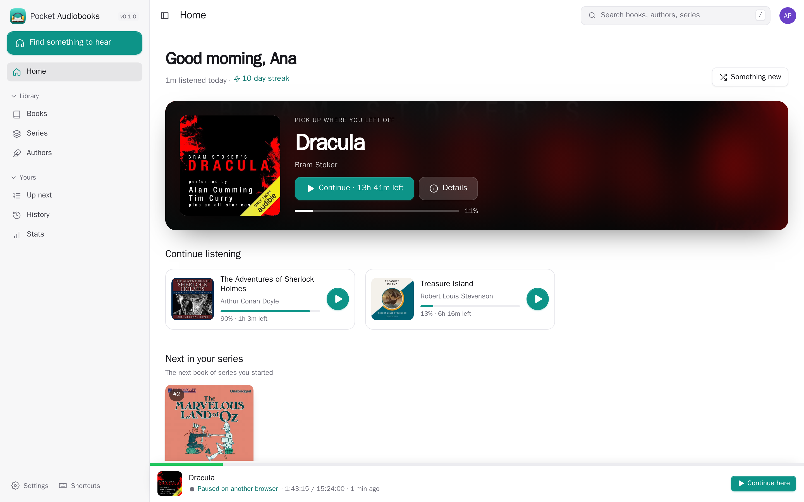
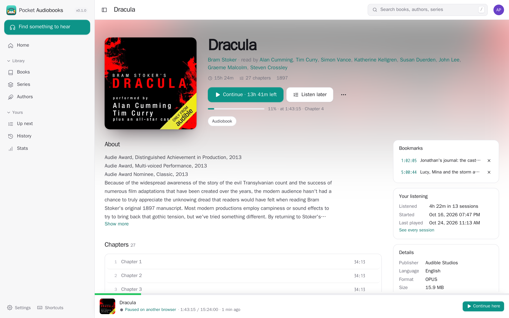
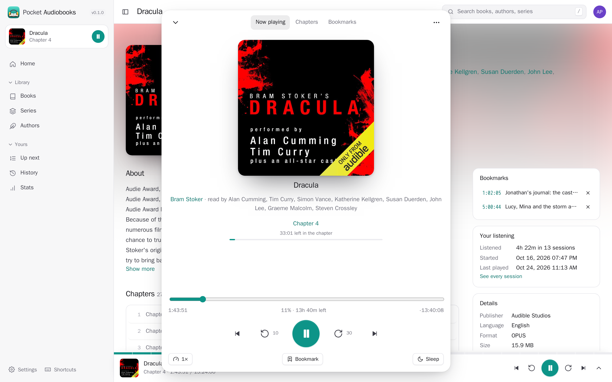
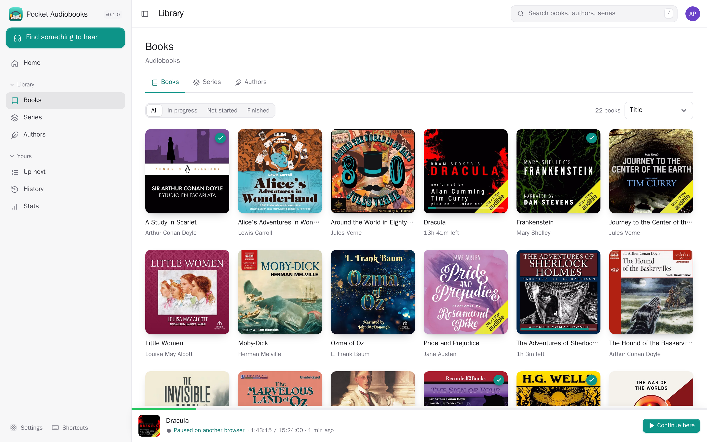
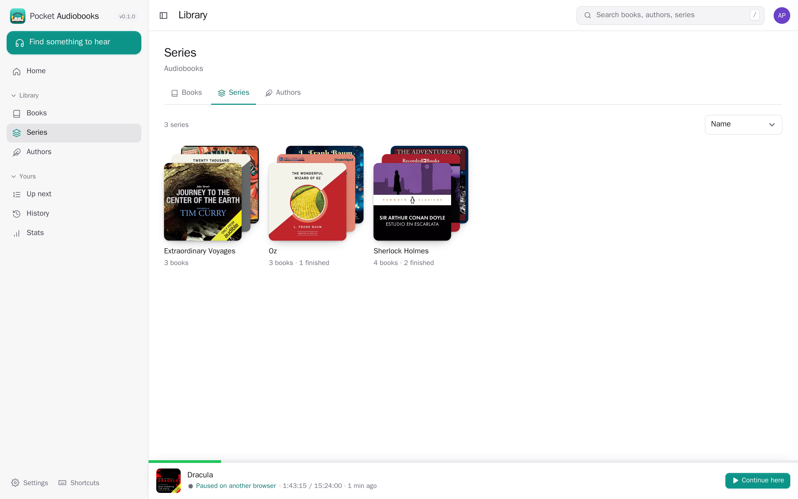
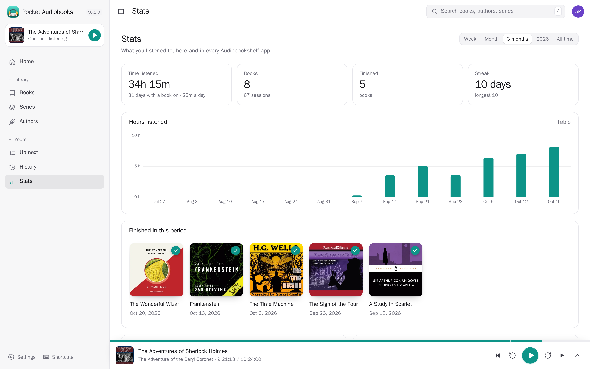
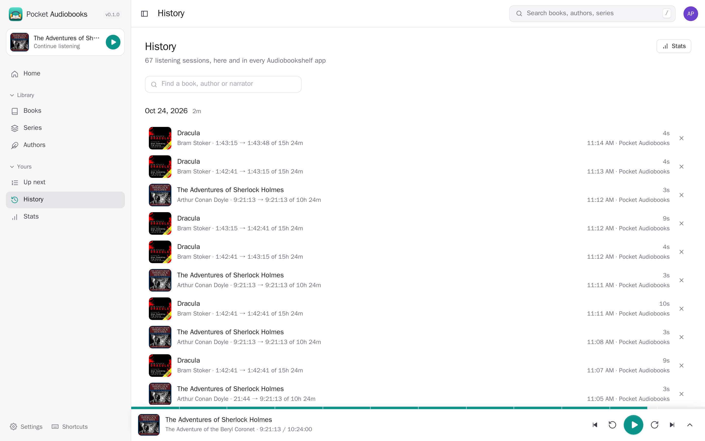
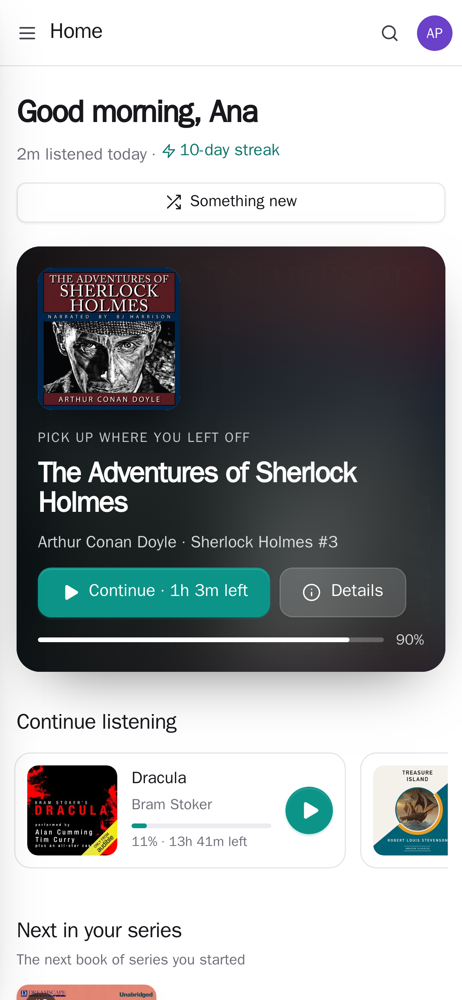
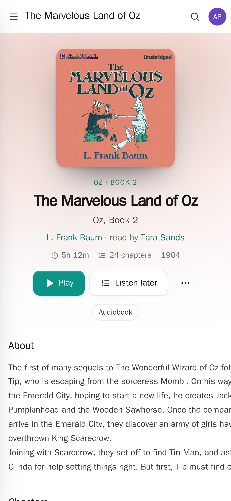
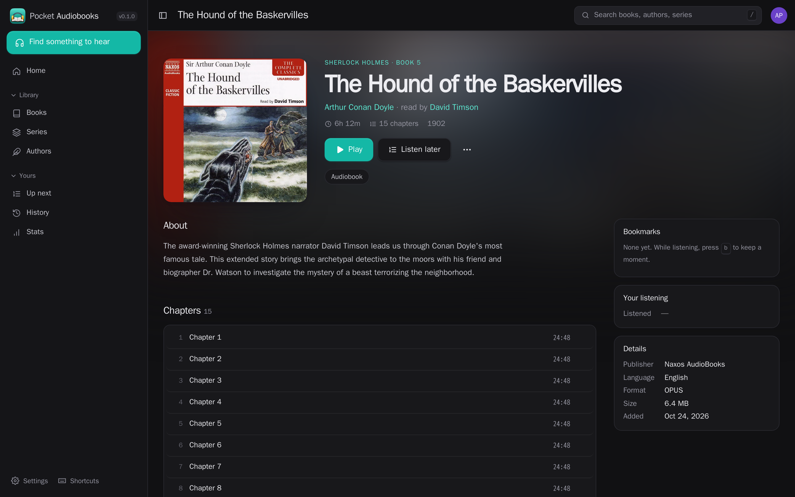

<p align="center"></p>
<h1 align="center">Pocket Audiobooks</h1>
<p align="center">A standalone audiobook library and player for the household. Scan your files, browse authors and series, listen with chapters, bookmarks, speed and a sleep timer, and keep your place across the web and Pocket Homelab.<br>Go, SQLite, React and local FFmpeg. No Audiobookshelf server required.</p>
<p align="center">
  <a href="https://github.com/abjelosevic88/pocket-homelab-audiobooks/actions"></a>
  <a href="https://github.com/abjelosevic88/pocket-homelab-audiobooks/pkgs/container/pocket-homelab-audiobooks"></a>
  <a href="LICENSE"></a>
</p>

---

<p align="center"></p>

<table>
  <tr>
    <td width="50%"></td>
    <td width="50%"></td>
  </tr>
  <tr>
    <td align="center"><sub>A book: your place, chapters to jump to, bookmarks, the rest of its series, how long you've listened.</sub></td>
    <td align="center"><sub>The player: chapters, speed, sleep timer (minutes or the end of the chapter), bookmarks; your place is saved every 15 s.</sub></td>
  </tr>
  <tr>
    <td width="50%"></td>
    <td width="50%"></td>
  </tr>
  <tr>
    <td align="center"><sub>The library: in progress, not started, finished; by title, author, length, last listened.</sub></td>
    <td align="center"><sub>Series, with how far you are in each.</sub></td>
  </tr>
  <tr>
    <td width="50%"></td>
    <td width="50%"></td>
  </tr>
  <tr>
    <td align="center"><sub>Stats from your history — here and in connected players: time, finished books, streaks.</sub></td>
    <td align="center"><sub>History, every listening session by day, with the device it played on.</sub></td>
  </tr>
</table>

<p align="center">
  &nbsp;&nbsp;
  &nbsp;&nbsp;
  
</p>

## Start

```sh
cp .env.example .env
mkdir -p data audiobooks
# The container runs as UID/GID 1000; give it access to these directories.
docker compose up -d
```

Open port 8080 and create the first account. Under **Settings → Libraries**, add
`/audiobooks` and start a scan. Mount additional folders in Compose before adding
them. Enable periodic scans to pick up new files automatically. Keep each book
in its own folder; multi-file books and CD/disc subfolders are supported.

## Listening and library management

- Chapters, speed per book, skip controls, sleep timer, bookmarks, lock-screen
  controls and Up next. Direct audio and local HLS conversion work across browsers.
- Saved positions, completion, history, statistics and device handoff. The web
  player retries unsent progress reports after reconnecting.
- Search, filters, authors, series, collections and personal playlists.
- Upload a book’s audio, cover and companion ebooks together. Files publish into
  a new book folder after validation; originals are not overwritten. Default
  upload limit: 10 GiB, configurable with `MAX_AUDIOBOOK_UPLOAD_BYTES`.
- Edit metadata, chapters and covers, preview provider matches, make bulk edits,
  reorder/exclude tracks, and export metadata or original-file downloads.
- Recoverable Trash, application backup/restore, M4B generation and metadata
  embedding. Generated files can be selected for playback while originals stay.
- EPUB/PDF reading and existing podcast support are available too. This is an
  audiobook app, not a promise of every Audiobookshelf feature.

## Connect Pocket Homelab

With Pocket Core, select **Pocket Audiobooks** under **Devices → Apps on your
devices → Audiobooks**, then refresh the app’s Core configuration. The paired
device token signs in automatically; no app password is needed.

For a manual connection, use this app’s base URL and a personal token from
**Settings → Apps & API** in the native app’s Audiobookshelf fields. The
compatibility API supports the existing player’s browse, playback, download,
bookmark and progress calls. The library and listening data live in Pocket
Audiobooks itself.

Other compatible players can use username/password sign-in with your Pocket
email and a separately revocable app password. Third-party apps can use different
API extensions; compatibility is tested at the protocol level, not on every app.

## Migration and backups

The migration command reads a consistent Audiobookshelf SQLite snapshot, maps
media folders and explicitly maps retained accounts. It preserves identifiers,
metadata, chapters, files, personal progress, bookmarks and listening history.
It defaults to a dry run and refuses a nonempty native catalog. See
[migration and verification](docs/standalone-migration.md).

Back up the application bundle **and the media folders**. Bundles include SQLite,
managed artwork, the encryption key and Core credentials; they do not contain
original audio or ebooks. Restore verifies checksums before creating a new data
directory. See [backup and restore](docs/backup.md).

## Pocket integrations

Pocket Core provides sign-in and paired-device authentication. Pocket Day and
Pocket Bookshelf read the signed-in person’s listening through enabled Core links.
Homepage has a dashboard endpoint, and personal notifications cover finished
books and the weekly recap.

[Configuration](docs/configuration.md) · [API](docs/api.md) ·
[Reverse proxy](docs/reverse-proxy.md) · [Design](docs/design.md)

## Development

```sh
npm ci --prefix web
npm run build --prefix web
go test ./...
go run ./cmd/pocket-audiobooks
```

The historical screenshots above use a generated public-domain demo library.
The native browser acceptance test exercises the current independent backend;
it requires a local Chromium CDP endpoint and FFmpeg/FFprobe. It never runs against
production data.

The old upstream gateway remains available only with explicit
`MEDIA_BACKEND=audiobookshelf` for rollback during migration. Native mode is the
default and does not use that server.
